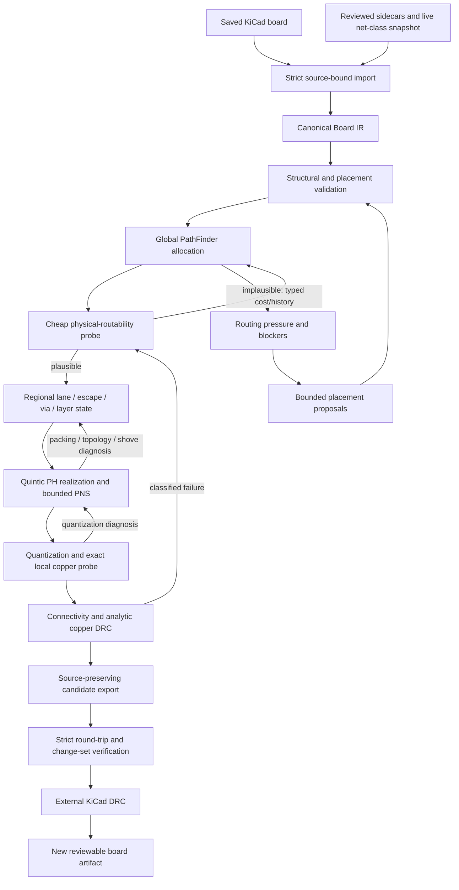

# Flux Capacitor implementation and design

## 1. Scope and current state

This document describes the implementation present in Flux Capacitor v0.129.0, using canonical board schema 19. It is a description of the working code, its execution flow, and its current limits. The ADRs under `docs/adr/` remain the detailed decision history; `plan.md` records the completed replacement of the old optional seed-guidance path. Schema 19 preserves an unfilled KiCad zone as an immutable requires-refill marker and never treats it as physical copper; only the explicitly provisional refill workflow may route such a source before KiCad refill, strict re-import, connectivity, and DRC. It also retains exact circular/oval pad-drill dimensions and pad-local offsets, using physical hole centres for non-plated obstacles and reusable plated-pad transitions.

Flux is an experimental C++20 placement-and-routing engine with KiCad as its first integration. Its defining design choice is that placement and routing operate on the same board model:

- routing produces spatial congestion, terminal-access, obstacle, corridor, and width-reduction evidence;
- placement consumes that evidence to propose bounded component changes;
- a placement is accepted only after a fresh global route, detailed copper construction, connectivity check, and copper DRC.

The implementation combines three distinct kinds of state:

1. **Topological state**: which obstacle side, corridor, layer sequence, terminal portal, sampled resource, and via transition a connection uses.
2. **Continuous geometric state**: chained quintic Pythagorean-hodograph (PH) interpolation nodes, Bézier/preimage coefficients, tangents, curvature, rational clearance offsets, lateral lane offsets, and elastic deformation within a selected corridor.
3. **Canonical physical state**: quantized KiCad-compatible straight tracks, three-point circular track arcs, vias, pads, and filled copper.

These states are intentionally not collapsed into one search problem. PathFinder negotiates a bounded polyline/resource model; NavMesh and PH chains select and optimize physical corridors; detailed routing converts accepted geometry to actual copper; exact validation remains the final authority.

## 2. System boundary



The target control architecture consists of three nested loops:

1. **Global feedback** teaches PathFinder that a topologically available resource can be physically difficult. A cheap probe converts packing, terminal, via and crossing pressure into bounded non-negative history costs.
2. **Regional realization feedback** alternates discrete lane/escape/via/layer decisions with continuous spline/PNS realization. Continuous failure changes a regional decision before the solver escalates back to global topology.
3. **Materialization feedback** exact-checks quantized canonical primitives and feeds a local clearance or primitive-fit constraint back to the continuous optimizer before escalating.

All loops exchange `RoutabilityDiagnosis` evidence. The evidence carries a typed failure, stage, stable resource identity, physical bounds/layer, affected nets, severity, optional planned versus observed capacity, and suggested relaxation. `RoutabilityKnowledge` accumulates repeated evidence deterministically with saturation. It is a search cost and diagnostic record only: it cannot make an illegal transition legal, suppress connectivity/DRC, or become canonical board state.

The current implementation interleaves all three loops. The caller's existing PathFinder iteration budget is divided across deterministic physical-feedback epochs rather than consumed by one long global wave. Each epoch rebuilds mandatory per-layer hydraulic alternatives from the latest failure/success terrain, runs PathFinder with the prior physical checkpoint as an affected-cone transaction, probes exact copper-envelope pressure, and performs a bounded regional lane/terminal/via/PH realization on the best retained topologies. Later epochs start directly in the mature bidirectional/congestion/hard-capacity policies instead of replaying the soft warm-up.

The planner keeps a bounded beam of distinct global topologies across epochs in addition to the global router's pass-local beam. Repeated failure expands the next affected set through recorded hard-capacity blockers and touched residual conflict groups; stagnation rotates through retained topologies and cannot stop the search while another configured epoch remains. Intermediate regional probes use smaller search/transaction bounds, while the final epoch applies the complete configured regional budgets to the best two retained physical candidates. The regional handoff is still feasibility-first by connectivity, incomplete assignments, overflow, then cost—not simply the most recent probe. Every epoch and retained-portfolio count is exposed through telemetry and CLI JSON.

History coalescing retains failure stage, suggested corrective action, participating net set, layer and physical bounds. Corridor/lane/layer diagnoses become major-axis hydraulic deposits; via/terminal diagnoses remain localized. This prevents a lane-order failure and a corridor-change failure in the same spatial bin from degenerating into one actionless scalar. Inside a regional window, failed shortlist states continue to select among topology-template, via, and lane-order alternatives. Resolved local diagnoses are observable but never become global history.

Quantized PH tessellations receive an analytic route-to-route envelope check. A continuous-clean quantization failure may spend two local basis-weighted control shoves; each candidate must reduce the exact quantized conflict count while preserving continuous topology and clearance. Detailed connectivity and copper DRC rejection is also classified by net/object, and the KiCad detail workflow may spend one final global/regional/materialization feedback pass. Integrated placement uses unresolved final diagnoses to promote connected or spatially implicated footprints, construct bounded region-directed moves, and expand incremental affected-net cones. Native-arc primitive feedback, obstacle-specific constraint projection, and removal of the older residual-only fallback remain incomplete.

The source `Board` is immutable to the algorithms. A route, shove, placement, or curved trace is a proposal on a board copy. Export writes a new file and refuses to overwrite an existing artifact. The live KiCad bridge can apply routing-only changes as one unsaved undo transaction after all gates pass. Live footprint mutation is withheld because a routing-only application of an accepted placement-dependent result would invalidate the transaction, and current whole-footprint IPC updates are not considered safe enough.

KiCad remains the owner of project rule configuration, zone refill policy, and final external DRC. Flux has an internal analytic DRC so it can reject bad search results early, but it does not claim to implement every KiCad rule.

## 3. Core invariants

The implementation is organized around the following invariants.

- All canonical coordinates and dimensions are signed integer nanometres. Floating-point math is confined to analytical placement and continuous curve calculations, then quantized before any authoritative check.
- Stable typed IDs identify nets, layers, footprints, pads, tracks, arcs, vias, constraints, and routing resources. Deterministic stable-ID ordering resolves all otherwise equal choices.
- The board material is the outer outline minus explicit cutouts. Copper-to-edge checks apply to both outer and cutout boundaries.
- Resolved routing rules are per net. Pairwise unlike-net clearance is the larger effective clearance of the two nets.
- Same-net copper may be omitted from a net-specific routing obstacle domain; foreign copper, keepouts, board boundaries, and unsupported objects may not be ignored.
- Polygonal offsets, Voronoi chords, sampled corridors, packed lanes, spline samples, and PNS results are evidence or proposals. None independently authorizes copper.
- A declared differential pair or routing bus is treated atomically wherever independent member decisions could break polarity, order, layer sequence, or via synchronization.
- Every expensive search and refinement has an explicit bound and accepts a `std::stop_token`.
- Failed optimizations fall back transactionally to an earlier complete representation. They are never repaired by keeping only the locally successful fragments.
- A publishable result must pass canonical structure/placement validation, represented connectivity, represented copper DRC, source-preserving KiCad round-trip checks, and the workflow's external KiCad DRC gate.

## 4. Canonical board model

`include/flux/core/board.hpp` defines schema 18. The model contains:

- board outline and cutouts;
- ordered copper and technical layers, including KiCad `power`-typed inner copper layers;
- nets, prioritized net classes, resolved default rules, differential pairs, and explicit ordered physical routing buses;
- footprints, placement transforms, locks, exact or tentative placement-envelope provenance, exact circular courtyard primitives, pads, and footprint-owned keepouts;
- board keepouts with independent track, via, pad, pour, and footprint prohibitions;
- straight track segments, native three-point circular `TrackArc` objects, through/span vias, and immutable saved zone-fill regions with holes;
- rigid placement groups, placement regions, and relative-placement constraints;
- a content-derived `source_revision` used to bind every external policy and candidate to the exact saved source.

Net-class properties inherit independently by priority. A class may supply width but not clearance, for example, and the missing property falls back through the next applicable class to the board default. The rule resolver is cached in routing hot paths.

Placement-envelope provenance matters. Exact courtyards and approved external envelopes authorize ordinary placement. Missing courtyards fail closed by default. The explicit proposal-first mode may derive a tentative bound from rotation-independent pad extents and supported Fab/Silk geometry. That provenance is retained, all normal legality gates still apply, and the result is marked for mandatory mechanical review.

## 5. KiCad ingestion and policy loading

### 5.1 Strict import

The KiCad importer parses the board S-expression into the canonical model. It supports the board and copper objects used by the current workflows, including rotated standard pads, board and footprint keepouts, native track arcs, circular courtyards, simple saved fills, and KiCad's fractured polygon-with-holes walks. Unsupported or lossy geometry is reported explicitly. Routing and optimization commands require `KicadImportResult::strict()`, meaning a board exists, no import error occurred, and the import was not lossy.

Pad angles are converted from KiCad's placed absolute orientation into footprint-local orientation on import. This prevents a footprint rotation from being applied twice during geometry checks.

### 5.2 Source-bound sidecars

KiCad syntax is not extended with invented Flux properties. Policies absent from the board format are loaded from deterministic sidecars bound to both the source revision and stable object IDs. Current sidecars cover:

- net classes and effective net membership;
- differential-pair hard gap/skew constraints;
- explicit ordered routing buses;
- footprint orientation/side constraints;
- reviewed placement envelopes;
- rigid placement groups;
- placement regions;
- relative placement tolerances;
- staged placement-move priorities.

The official `kicad-python` IPC bridge is read-only when capturing live project net-class data. It verifies that the open document path matches the requested saved file and that the saved bytes do not change during capture.

## 6. Geometry and free-space services

Flux applies slicer-derived ideas as a clean-room PCB adaptation: obstacle inflation, polygon Boolean operations, medial structure, cross-section capacity, path ordering, parallel lanes, curve simplification, and spatial acceleration. Slicer code is a reference for algorithms, not a source of copied AGPL implementation.

### 6.1 Authoritative and prepared geometry

The geometry layer implements transforms, point location, segment/polygon distance, intersection, arc parameters, and copper-distance predicates. `PreparedPolygon` stores:

- cached polygon bounds;
- immutable boundary segments and segment AABBs;
- a deterministic median-split BVH.

Point-location and nearest-boundary operations share the prepared object. Saved-zone outer/hole queries and spline clearance evaluators reuse the same preparation.

The global obstacle index stores immutable obstacle geometry and cached net rules. Its board lattice uses flat spatial bins. Per-thread generation stamps deduplicate query results without a fresh tree or `std::set` allocation for every edge test. Worker forks share immutable geometry but own mutable edge/access caches, counters, and scratch state.

### 6.2 Net/layer free-space extraction

`extract_polygonal_board_free_space` builds a free-space domain for one routed net and one layer:

1. retain the exact board outline and cutouts;
2. add foreign pads, vias, existing tracks/arcs where representable, fills, and applicable keepouts as obstacles;
3. omit same-net copper so a route may connect to it;
4. identify conservative approximations separately; and
5. report unsupported shapes as promotion blockers.

Circles are conservatively circumscribed, ovals and rounded rectangles use enclosing rotated rectangles where required by the polygonal service, and segment/via copper uses enclosing polygons. Exact shape-aware predicates remain authoritative after this conservative planning stage.

Saved fills are physical obstacles by default. Only the explicit refillable-zone transaction may omit them while planning, and that transaction cannot complete until KiCad refills a separate candidate and the refilled board is re-imported and DRC checked.

### 6.3 Clearance expansion

The free-space offset service turns finite-width routing into a centreline problem. It erodes the board, dilates polygonal obstacles, performs Boolean subtraction, and preserves disconnected outer and hole regions. The offset distance represents the trace radius plus the applicable clearance. A two-nanometre rounding guard and post-operation source-boundary rechecks make the integer-miter result conservative. It is deliberately not described as an exact circular Minkowski offset.

### 6.4 Voronoi skeleton

Boost.Polygon constructs a pitch-independent integer segment-site Voronoi skeleton from free-space boundaries. Flux publishes only finite, quantized straight chords that independently remain in represented free space and meet their recomputed minimum boundary clearance.

A finite parabolic point/segment bisector may contribute only its straight endpoint chord. That chord is deduplicated and exact-rechecked as a new proposal; it never inherits clearance from the unquantized curve. Infinite and failed edges are withheld and counted.

For an accepted medial edge, local channel width is twice the verified nearest-boundary distance. Capacity is computed from real copper envelopes rather than node count. For equal-width lanes the conservative count is derived from track width and inter-lane clearance. Shared allocation extends this to heterogeneous widths and declared pair/bus envelopes.

### 6.5 Rectilinear NavMesh and funnel

The NavMesh is a bounded mixed-resolution rectilinear polygonal-cell decomposition, not a general triangle mesh. It is built inside a clearance-offset free-space region. A coarse cell clipped by a clearance boundary is recursively divided into four children under explicit depth, pitch, and cell-count bounds; each retained child edge, diagonal, and pulled centerline chord is independently certified. Global portfolio construction defaults to one subdivision level, while bounded regional and detailed windows use two so fine geometry is paid for only after topology has narrowed the search.

Construction is split in two:

- `prepare_navmesh_domain` creates endpoint-independent checked cells, prepared polygons, a flat coarse-coordinate-to-leaf lookup, and deterministic exact shared-face adjacency between differently sized cells;
- `route_prepared_navmesh_flood_fill` binds one start and one or more goals, runs a bounded reverse wavefront, and reconstructs a corridor by following strictly decreasing integer distance labels in a fixed neighbor order;
- `route_prepared_navmesh` is the single-goal production wrapper, then builds ordered portals and runs the funnel/string-pulling algorithm.

The flood is the micromouse-style part of topology discovery. Uniform domains retain the ordinary breadth-first raster field. Mixed-resolution domains use physical-distance edge weights on a compact CSR graph, with GPU relaxation for sufficiently large graphs and deterministic CPU Dijkstra completion if the bounded GPU wave has not reached the start. Its walls are precisely the missing cells of the prepared clearance-expanded domain. Sorted goals and fixed adjacency order make ties deterministic. A multi-goal query selects the first reachable minimum-distance goal under those stable ties. Visited cells, refined/rejected leaves, GPU use, and CPU completion are observable. Exhaustion returns no corridor; it does not prove geometric impossibility.

The resulting route carries its corridor cells, portals, centerline, and a flat guard-cell mask. The guard is a homotopy constraint: a point can be legal in board free space yet be rejected by the spline optimizer because leaving the selected cells could silently change obstacle side.

## 7. Global routing

The global router answers two questions: whether every connection has a realizable topology, and whether all routes can be allocated without exceeding represented capacity. It does not emit final copper.

### 7.1 Routing tasks and graph

After validating the board, `route_global_impl`:

1. resolves selected-net and priority scope and rejects a scope that splits a pair or bus;
2. creates a multilayer lattice over board copper layers;
3. builds the immutable obstacle index;
4. scan-converts legal planar edges into slicer-style constant-cross-section corridor resources;
5. optionally builds a second, narrow-width corridor graph;
6. builds net-specific Voronoi guidance and the shared physical Voronoi allocation graph;
7. computes exact terminal access portals; and
8. creates one multi-terminal `NetTask` per incomplete named net.

Planar search defaults to a 0.5 mm lattice and can be orthogonal, checkerboard diagonal, or crossing-safe dual diagonal. The lattice selects sampled topology; it is not a constraint on PH interpolation nodes or final copper coordinates. In the dual-diagonal mode both diagonals are searchable, but they share a cell-capacity resource so two unlike nets cannot pass through the geometric crossing unnoticed. Via transitions occur at all lattice nodes selected by a separately pitched and phased via-site sublattice. When its pitch is omitted, the router derives the smallest exact lattice multiple that preserves resolved via-to-via spacing; refining the planar topology must not create physically impossible via sites.

The optional direct-medial graph promotes a certified Voronoi chord to one graph transition between snapped portals. The snapped chord is rechecked and its capacity reduced to the smaller of the source and snapped certificates. If the hybrid search fails, one separately bounded sampled graph retry preserves baseline feasibility.

### 7.2 Terminal access

A pad's nearest lattice point is only a preference. For each terminal the router:

1. tries exact legal access paths to the nearest node;
2. if none succeeds, explores bounded Chebyshev rings in stable order;
3. optionally retains legal portals from more than the first successful ring;
4. may use a finer local 45-degree escape mesh between the exact pad and the coarse portal; and
5. rejects a geometrically legal portal if it has no legal egress into the global graph.

Every straight or orthogonal stub is checked at resolved width and clearance against pads, copper, keepouts, and board boundaries. Failed escape evidence retains footprint, pad, net, and position.

Ordinary, uncoupled nets may use explicit bounded neck-down policies. Nominal width is always tried first. A narrower terminal stub, direct medial chord, or sampled corridor run is allowed only with an explicit width and maximum physical length, exact narrow-width legality, and nominal-width transition disks. Width mode and run length are part of A* state; width is not inferred after a route is found. Pair and bus members are excluded from independent neck-down decisions.

### 7.3 Mandatory static seed portfolio

Before negotiated congestion, every net is evaluated against empty occupancy and history. This is the first global plan, not disposable guidance.

For each net:

1. Start with the terminal having the fewest legal portals.
2. Grow a complete tree by searching from all portals of the next constrained terminal to every node already in the tree.
3. Use the same hybrid graph and exact legality predicates as ordinary routing.
4. Generate a small topology portfolio containing the shortest tree, a positively edge-diversified tree, a deterministic bidirectional RRT-Connect corridor, and a mandatory per-layer hydraulic-erosion attempt. A failed bounded hydraulic generator is reported; it is never silently disabled or replaced by a configuration switch.
5. Deduplicate by graph topology and layer/resource sequence rather than approximate length.
6. Keep the complete tree atomic; a partial tree contributes diagnostics but owns no capacity.

Alternative construction remains sequential within a net. Complete net tasks run in parallel. Results occupy stable task-index slots and are reduced in original order, so worker completion order and worker count do not change route bytes. Configured search and corridor budgets are partitioned deterministically across tasks.

Declared differential-pair and bus candidates pass an ordered synchronization barrier before continuous refinement. Incompatible member topology is withheld atomically.

The mandatory hydraulic family adapts the integer, batch-synchronous compute pattern used by the local LittlePlanets terrain implementation. For each actual copper layer independently, it first rasterizes the prepared clearance-expanded polygonal free-space domain at a finer pitch than the coarse NavMesh. Represented pads, vias, copper, keepouts, holes, and board exterior are immutable infinite-height cells; the target terminal/via is a zero-height sink. A reverse integer potential relaxation is followed by deterministic droplet batches. Flow is accumulated atomically inside a frozen batch, then high-flow cells are eroded between batches so later droplets prefer the established riverbed. Early batches retain bounded downhill exploration; each flowing cell also erodes its immediate banks with a lower weight, producing a corridor-width field rather than a one-cell filament. A bounded obstacle-clearance reward pulls discovery away from fragile obstacle grazing without overriding the target potential. The solver retains destination potential, post-erosion terrain, clearance, flow, and free-space mask as row-major fields.

Bounded feedback retries also rasterize downstream routing knowledge into that per-net/per-layer terrain. PathFinder and corridor overflow deposit slowly increasing pressure; terminal, PH, XPBD/PNS, and via failures receive progressively stronger local pressure; and a collision rejected at final quantized-copper validation receives the strongest pressure. Resource bounds preserve the bottleneck's longitudinal extent rather than charging an entire layer. Conversely, each clean quantized track or arc contributes one unit of separately stored success evidence. Repeated clean evidence initializes a capped erosion prior on the next hydraulic attempt. Positive evidence never subtracts PathFinder history or authorizes illegal cells, and all additions are saturating and bounded by the ordinary knowledge and erosion limits.

The riverbed is exact-chord-certified and visibility-pulled in polygonal free space before it is projected into coarse NavMesh cells. It then opens a bounded coarse tube used by the ordinary reverse flood, funnel, topology signature, graph reprojection, connectivity, and DRC gates. Consequently erosion discovers free-space topology while the NavMesh remains a coarse occupancy/resource and certificate projection. A multi-layer candidate consists of distinct layer-specific riverbeds joined only by explicit validated via choices. The family remains retained fallback evidence if it is not selected. Telemetry publishes the fine discovery field at its own origin/pitch plus projection/certificate metrics; it never presents NavMesh pixels as the discovery authority.

Vulkan acceleration is a build and production-routing prerequisite. Requested hydraulic work never falls back after device initialization, allocation, or dispatch failure; such a candidate fails closed. The deterministic CPU implementation remains only for equivalence tests and isolated oracles and must produce identical integer fields.

Hydraulic, shared routing compute, and XPBD use one process-wide Vulkan instance, deliberately selected physical device, logical device, compute queue, memory-allocation service, and driver pipeline cache. `FLUX_VULKAN_DEVICE` may select a compute-capable device by enumeration index or a case-sensitive device-name substring; an invalid override fails GPU initialization rather than silently selecting another adapter. Queue submission is externally synchronized only around `vkQueueSubmit`; an eight-fence in-flight ring replaces device-wide `vkQueueWaitIdle`, allowing independent command buffers to be queued while earlier callers wait for their own completion.

Hydraulic domain rasterization and clearance preparation are fused into the hydraulic command stream. Immutable outline/cutout boundary segments are uploaded as compact relative geometry; one invocation per cell produces walkability, nearest-boundary distance, obstacle identity, and the initial terrain without a prepared-polygon query in the serial host loop. Because droplets use only positive clearance inside walkable free space, the shader initializes obstacle and raster-edge cells to zero and performs the exact four-neighbour Manhattan relaxation directly into its two clearance buffers. It does not construct or read back the unused negative half of the generic signed field. Potential relaxation and droplets consume the final clearance buffer in place. A device-side block reduction normalizes and compacts terrain, clearance, erosion, flow, pressure, and success fields to at most 64 by 64, extracts maxima and free-cell counts, and traces the riverbed through the predecessor field. Ordinary discovery reads back only those compact fields, summaries, and the riverbed. The last 16 distinct `(width, height, exact walkable mask)` clearance fields are retained behind a 64-bit hash plus full mask equality check. A hit uploads the proven positive field into the persistent job slot and omits clearance relaxation; hash collisions cannot change geometry.

Concurrent static-seed requests enter a bounded micro-batcher. It retains stable request/result indices, collects at most eight independent jobs for a short bounded interval, records all jobs in one command buffer, and submits them under one fence. Eight persistent job slots own their mapped buffers and descriptor sets. Buffer capacities grow geometrically and survive subsequent calls; the descriptor sets are updated only to point at the retained or newly grown allocations. A batch therefore amortizes queue submission while repeated domains avoid the former per-call buffer, memory, descriptor-pool, and command-buffer churn. Batch membership never changes a job's integer arithmetic, seed, result, or authoritative downstream gates.

### 7.3.1 Shared advisory routing compute

Hydraulic erosion now shares the Vulkan-capable execution boundary with the other bounded, data-parallel routing workloads:

1. basis-weighted batches of flattened quintic PH Bézier sample positions;
2. multi-source micromouse wavefront and obstacle-clearance fields;
3. end-to-end PH proxy scoring for length, curvature/change, bend radius, SDF clearance, corridor containment, and approximate self-intersection, followed by exact route-level CPU tasks only for the stable top-K;
4. shared primitive-AABB and segment conflict broad phases used to shortlist track, arc, via, and pad pairs before authoritative dynamic DRC;
5. batched chord/boundary visibility classification, where only conservatively clear chords skip the full boundary-distance scan and ambiguous topology stays exact;
6. via-pair and terminal-run-up/via physical-envelope screening;
7. regional via-site filtering across complete layer spans, including immutable obstacles, already planned vias, run-up envelopes, layer validity, approximate copper conflicts, run-up length, and corridor-pressure terms; the device publishes a rejection bitmap and stable bounded shortlist while the branchy joint state search remains on the CPU;
8. regional portfolio and placement-wave feasibility pre-scores; and
9. prepared-NavMesh reverse flood-fill families, including sparse weighted CSR wavefronts for adaptive mixed-resolution cells.

The combined compute shader uses compact relative-coordinate buffers and fixed-order dispatches. Work below an explicit arithmetic threshold remains on the CPU so dispatch and synchronization do not dominate small regional windows. Wavefront dispatch depth is also bounded geometrically; an incomplete field falls through to the ordinary exact CPU queue. Large candidate-pair arrays are bounded before allocation and disable their broad phase on exhaustion rather than dropping pairs.

GPU floating-point geometry is never route authority. Physical envelopes include a numeric guard; a reported possible collision is re-evaluated by the existing long-double geometry, while only a conservatively separated pair may skip that exact loop. GPU PH Bézier positions are used only for the clearance broad phase; CPU spline shape, topology, curvature, quantization, connectivity, and DRC checks remain mandatory. Likewise, GPU scores only order work inside already bounded waves and do not replace feasibility-first comparison. Every entry point retains a deterministic CPU reference for equivalence and exact follow-up work. Small auxiliary workloads may deliberately remain on the CPU when dispatch would dominate, but a working Vulkan compute device is required before routing begins. Mandatory hydraulic discovery never silently falls back when Vulkan creation, packing, compilation, or dispatch fails.

### 7.4 Early NavMesh/PH/PNS refinement

Each surviving same-layer, equal-width seed run is processed as:

```text
clearance-expanded free space
    -> prepared rectilinear NavMesh
    -> bounded reverse flood-fill, RRT-Connect, or hydraulic riverbed corridor
    -> funnel centerline
    -> tangent-continuous quintic PH Bézier chain
    -> continuous trajectory optimization
    -> adaptive tessellation and collision envelope
    -> bounded PNS or basis-weighted control shove
    -> updated control corridor and refit
    -> exact hybrid-graph reprojection
```

The continuous result is never converted directly into PathFinder authority. Its tessellation defines a bounded graph corridor, then `corridor_reprojection` runs exact graph search between the original portals. It adds a non-negative cost for departing from the spline corridor but retains all obstacle, width, and topology checks. Failure keeps the original exact static route.

Successful reprojection stores both the conventional graph path and the geometric corridor:

- selected NavMesh topology cells and portals;
- optimized PH lane-centre tessellation;
- required `track width + 2 * clearance` envelope;
- conservative minimum physical cross-section width;
- lane capacity;
- whether the selected graph path stayed inside the topology guard.

This is how the PH chain remains a core part of the global plan without putting floating-point preimage or Bézier state into PathFinder. Later negotiated searches pay a corridor-departure cost, and the selected global path carries its continuous corridor to detailed routing.

If a refined seed collides with movable existing copper, the early PNS pass can retain a concrete track/via delta and planning-board variant. A mere shove hypothesis cannot authorize a path.

### 7.5 Quintic PH trajectory representation and objective

The continuous implementation is a chain of planar quintic PH Bézier segments. A segment is generated from the square of a quadratic complex Bernstein preimage. Hermite interpolation ranks all formal square-root/quadratic branches by loop, inflection, absolute-rotation, length, and control-hull evidence; it does not accept the first algebraic root. Centripetal parameter selection is the default. Adjacent segments share one nodal derivative and account for non-uniform parameter spans, giving C1 continuity with respect to the route parameter. An explicit higher-order mode relaxes shared derivatives and fails closed unless C2 mismatch reaches its tolerance.

The PH state stores the quadratic preimage, six Bézier controls, quartic speed, and exact quintic arc-length polynomial. Rebuilding a span also computes immutable power-basis coefficients for `w`, `w^2`, position, speed, arc length, and the curvature numerator. Hot position and differential evaluation uses Horner form; regularity and differential operations work on quadratic `w` rather than reconstructing the quintic. Real roots of the cached hodograph components give exact positional bounds, and cusp, inflection, and curvature-extremum parameters are cached for DRC and contact broadphase. Curvature extrema are roots of the degree-five derivative numerator and inflections are isolated roots of the quadratic curvature numerator. Exact signed offsets are homogeneous rational degree-nine Bézier curves; bounded rational subdivision plus Newton refinement detects their intersections at the final regional envelope gate. Arbitrary Bézier control motion is forbidden because it would destroy the PH invariant. XPBD and elastic shove move interpolation nodes, then rebuild every affected PH segment before the candidate is assessed.

Eligible detailed chains first receive an advisory whole-chain Vulkan XPBD precondition. Fixed pad/junction endpoints have zero inverse mass; intermediate PH interpolation nodes are particles; route spans supply stretch constraints; a route-local Laplacian supplies bending tension; and the selected corridor anchors bound displacement. All iterations for one chain remain resident in one device dispatch. The returned node vector occupies the original stable chain slot and is accepted only when the CPU feasibility-first shape plus continuous-corridor assessment improves. Vulkan failure falls back to the existing CPU optimizer, and the CPU remains authoritative for PH cache rebuild, homotopy, adaptive convex-hull certification, primitive fitting, connectivity, DRC, and transaction commit. Results expose attempts, device dispatches, CPU fallbacks, accepted GPU preconditions, and device solve time.

The subsequent coordinate-polishing loop is GPU-shortlisted as well. For each interpolation node, all axis, diagonal, shortening, Laplacian, biharmonic, and obstacle-normal proposals are rebuilt as PH candidates and packed candidate-major into one Vulkan spline-evaluation dispatch. Device samples provide a stable approximate ordering by represented legality, length, and turning cost. Only the best bounded four proposals receive the irregular long-double shape and adaptive convex- hull certificates. These fine-grained checks stay serial: measured recursive long-tail imbalance left most workers waiting and regressed wall time. Parallelism is instead applied after the full polyline board exists. Each complete same-layer degree-two route chain independently prepares its NavMesh, optimizes its PH trajectory, certifies it, fits native arcs, and tries bounded PNS against the same immutable board snapshot. Workers publish compact copper deltas to stable task slots. Original route-order reduction applies each delta to a disposable current-board transaction and rechecks structural validity, touched-copper DRC, and connectivity before the sole commit. If the device batch is unavailable, every proposal follows the original CPU path. Candidate-generation budgets and stable proposal-index tie breaks are unchanged; GPU ranking and parallel completion order cannot authorize a candidate.

Pads and vias at an exact chain node are explicit attachment boundaries. Failed route tasks retain stable net, layer, route-base, point-count, stage, NavMesh, topology, and materialization details in `spline_route_failure_details`; aggregate counters alone cannot distinguish whether a remaining staircase needs free-space, trajectory, connectivity, or quantization work.

KiCad's routed-copper grammar contains segment, via, and circular track-arc primitives, but no electrical Bézier track. Flux therefore keeps the quintic PH Bézier chain as the authoritative continuous optimization representation and adaptively approximates it with connected native track arcs/segments for KiCad. Exporting a graphical Bézier on a copper layer would not create routed-net copper and is forbidden. An incomplete preview retains every individually exact-accepted curved route even when other angular routes keep the complete curved-route gate unsatisfied.

A curve revision has one explicit preparation boundary. It computes, in order, the quadratic preimage coefficients, quartic squared-preimage/hodograph coefficients, integrated quintic position, quartic speed, integrated exact arc length, the quadratic curvature numerator, and then all root- derived bounds and extrema. The resulting segment is immutable until an interpolation node changes. DRC, contact, broadphase, tessellation, trajectory, length, curvature, and offset queries read those prepared coefficients; none rebuilds knots, derivative controls, or basis vectors in a hot query. Signed-offset construction likewise prepares its rational degree-nine power coefficients once so subsequent contact evaluation is Horner-only.

Control-coordinate descent uses a weighted objective containing:

- physical length;
- curvature magnitude;
- minimum bend-radius penalty;
- represented obstacle clearance;
- preferred entry and exit tangents;
- curvature-change continuity;
- elastic distance from corridor anchors;
- unnecessary control complexity.

Candidates are compared lexicographically by represented violation count and then objective, so a shorter illegal curve cannot beat a legal curve. Moves are clamped to the configured control corridor and, when supplied, the NavMesh topology guard. Analytical derivatives provide tangent, curvature, and bend radius.

Collision-local elastic deformation uses compact nodal influence:

```text
Q_i' = Q_i + alpha_i * d * n
```

Here `Q_i` is a PH interpolation node, `n` is the obstacle normal, `d` is the bounded displacement, and `alpha_i` is the compact normalized nodal influence at the collision parameter. Only locally influential controls move; endpoint and endpoint-tangent controls remain fixed. Endpoint changes use a related local falloff followed by the same constrained optimizer. If elastic recovery fails, the caller must replan the corridor.

### 7.6 Iteration-zero checkpoint

The router evaluates each uniform static-tree candidate index and two deterministic weak-occupancy portfolios during staged-priority qualification. Both reuse the already generated alternatives, so neither adds an A *wave. The baseline walks the established stable-priority order. The staged portfolio first aggregates each net, declared differential pair, or ordered bus into one atomic group and derives `RoutingSeedPriorityEvidence` from the filtered terminals and static portfolio:

- minimum terminal portal count;
- viable complete tree and corridor-bearing candidate counts;
- distinct coarse topology and layer-sequence counts;
- primary-route sampled-node/edge interference;
- resolved group copper envelope;
- primary-route extent.

Integer board-relative quartiles separate short non-contentious, constrained/high-interference, ordinary, and highly flexible groups. Explicit routing priority remains the first comparison key; the four waves apply within each priority stratum, and stable IDs are final tie-breaks. Correlated access/topology observations are collapsed so a board whose first legal terminal ring exposes one portal everywhere does not classify every net as constrained. Pair polarity and declared bus order remain contiguous inside their group.

Each weak-occupancy portfolio selects complete trees using provisional sampled-edge/node, clearance-shadow, corridor, and shared-resource pressure before adding them to occupancy. During qualification, the staged result may enter the ordinary portfolio comparator only if the baseline does not beat it under the feasibility-first objective and it creates no additional clearance-shadow conflict. CLI evidence records both results, qualification, selected identity, wave membership, and every classification input. The baseline path is scheduled for deletion only after the owned fixture and ESC gate passes.

The selected portfolio reconstructs canonical occupancy for sampled nodes and edges, diagonal crossing cells, corridors, controlled-width corridors, physical Voronoi resources, terminal stubs, and clearance shadows. This becomes iteration zero.

Iteration zero participates in the same feasibility-first comparator as later negotiated passes and seeds history from its conflicts. A later pass cannot displace it merely because it has lower weighted search cost while routing fewer nets or increasing overflow.

### 7.7 Negotiated PathFinder allocation

Subsequent passes run A* or bounded weighted-A* over the common graph. A transition cost is the saturating sum of applicable terms:

```text
physical step or via cost
+ sampled node/edge present and history cost
+ corridor present and history cost
+ physical Voronoi-resource present and history cost
+ clearance-shadow present and history cost
+ non-negative medial/corridor centering guidance
+ spline-corridor departure cost
+ explicit-width loss cost
+ pair/bus cohesion or selected-junction history
```

The heuristic remains physical-distance admissible in ordinary search. A bounded weighted retry may either restart or re-key the live frontier after an expansion limit.

Soft passes allow overflow and update history. A configured late hard-capacity phase rejects a transition that would exceed sampled, corridor, or shared physical capacity. Failed strict routes record the occupying nets. Bounded conflict-set repair may rip complete blocking nets, retry the failed net, defer victims, and roll the complete attempt back if recovery fails.

Multi-terminal ownership can be atomic: occupancy is committed only when the complete tree connects. Selective rerouting may preserve revalidated complete trees that do not participate in a conflict cone, with periodic full refresh available to escape a poor reuse basin.

Between incomplete passes, route ordering may change. Explicit net priority remains first. Unrouted and high-pressure groups are promoted while a differential pair or ordered bus stays contiguous and internally ordered. Optional physical-envelope ordering places wider groups first.

### # 7.7.1 Bounded diversification and large-neighborhood escape

The opt-in search-diversification policy makes negotiated routing less committed to its first complete topology without weakening any acceptance gate. Iteration-zero evidence now also carries a saturating routing-freedom score. It is the product of bounded terminal-portal, complete corridor, topology, layer-sequence, and viable-via factors. Smaller non-zero values identify groups with fewer ways out; explicit priority and the staged routing class still precede this score, and declared pair/bus members remain one atomic scheduling group.

Incomplete passes cycle through bounded deterministic ordering strategies: least routing freedom, longest route, shortest route, highest fanout, fewest corridor choices, fewest terminal portals, fewest layer choices with wider envelopes first, and a seeded pseudo-random permutation. The seed is configuration, so the policy explores different orders without making an identical run irreproducible. The ordinary pressure-based promotion remains ahead of each variant.

Flux retains a beam of 2 --32 feasibility-first checkpoints with distinct route-topology signatures. It stores complete `GlobalRouteResult` snapshots in the current implementation, bounds the default beam at eight, reduces them with the existing unrouted/overflow/cost comparator, and uses them as restart states. The beam is internal search state: an inferior or illegal member can never replace the best checkpoint merely because it is diverse.

After a configured number of non-improving passes, large-neighborhood search progressively unfreezes:

1. the highest-pressure hotspot and its directly conflicting nets;
2. another ring of sampled, corridor, physical-resource, and clearance-shadow neighbours;
3. all nets reached through the affected resource/portal cone;
4. the complete intersecting residual routing region; and
5. a bounded terminal/via-cluster perturbation augmented by a deterministic configured percentage of routes and the same number of high-pressure routes.

Every expansion is closed over declared differential-pair and routing-bus membership before reuse is prepared. Unaffected complete trees are revalidated and remain frozen; the selected neighborhood is ripped up and rebuilt from a retained beam checkpoint. This is controlled destruction, not a partial shove commit.

Soft negotiation deliberately permits sampled overflow, corridor over-capacity, clearance-shadow overlap, crossing pressure, and via contention. These states acquire present/history costs and are counted as temporary-illegal checkpoints. They may seed another search pass or beam restart, but they cannot pass the zero-overflow completion gate or authorize detailed copper. Hard-capacity passes, regional exact checks, quantized connectivity, copper DRC, and transactional commit remain unchanged.

The CLI enables the policy with `--search-diversification`; this also enables atomic complete-net routing, which is a mandatory prerequisite. Results expose the beam peak and accepted-candidate count, ordering variants, temporary-illegal checkpoints, destroyed-net total, coupled-group expansions, and ordered destruction operators. `NetQueued` telemetry includes the routing-freedom score, while every neighborhood action emits a bounded `SearchSummary`. Disabled behavior retains the previous negotiated ordering and checkpoint path; freedom evidence still refines the default constrained iteration-zero wave.

### 7.8 Physical resources and lane packing

Flux tracks several non-interchangeable capacity dimensions:

- **sampled resources**: lattice nodes, planar edges, via edges, direct-medial transitions, and diagonal crossing cells, normally with integer capacity;
- ** scan-converted corridors* *:grouped adjacent free lanes with integer lane capacity;
- ** shared Voronoi resources* *:physical channel width in nanometres with per-net `width + 2 ** clearance` demand;
- **clearance shadows**: actual width-aware overlap between selected track/via/access envelopes, attributed to both participants and to the sampled edge or portal that cast the shadow.

For several uses of one shared resource by a net, the maximum selected demand is retained so a narrow branch cannot hide nominal-width copper. Differential-pair demand contains both widths, the effective internal gap, and external clearances. Bus demand preserves declared order and heterogeneous widths.

After allocation, an uncongested shared medial resource receives a deterministic advisory cross-section packing. The complete occupied envelope is centered; pair members remain adjacent and bus members retain order. Shifted chords are checked against static geometry. At selected junctions a bounded orientation search may flip cross sections and construct direct or mitered lane bridges. These products are still evidence until detailed materialization proves terminal joins, mutual spacing, connectivity, and whole-board DRC.

### 7.9 Clearance-shadow negotiation and residual groups

Sampled occupancy alone misses physically incompatible sub-grid paths. The current router creates a bounded clearance-shadow resource when a selected sampled polyline, terminal stub, or via envelope overlaps another selected route's required copper envelope.

The normal negotiation phase charges the candidate-side resource. If it stagnates with shadows remaining, one bounded fallback window also adds coalesced history to the attributed owner's actual edge or portal. An optional deficit quantum changes pressure to `max(1, ceil(clearance deficit/quantum))`; zero uses one unit per conflict and remains the default. Conflict count, not weighted pressure, remains the feasibility dimension.

All over-capacity resources are unioned by participating net into deterministic residual conflict groups. Each group records its nets, resource identities, separate overflow dimensions, path and multilayer counts, peak geometric lane capacity, and whether all nets retain topology-preserved geometric corridors.

The CLI's opt-in post-negotiation spatial repair assigns conflict midpoints to layer-local tiles four grid pitches wide. It considers at most two pressure-ordered cones and 12 hard passes per cone. Each attempt invalidates all sampled, physical, and shadow participants, reroutes complete nets with diversified portals and hard capacity, and commits only if the canonical global comparator says the board is strictly better.

### 7.10 Global checkpoint selection

The default global comparator minimizes, in order:

1. unrouted-net count;
2. aggregate overflow;
3. unaccepted selected medial-lane transitions;
4. global route cost; and
5. for an otherwise equal key, prefers more retained paths.

The optional dimensioned objective replaces aggregate overflow with total and peak physical overflow, sampled overflow, corridor overflow, and congested physical-resource count. Neither objective permits cost to hide a feasibility regression.

Global routing is complete only when every selected connection is present and every represented overflow is zero. A separately bounded detailed handoff may consume certain nonzero-overflow checkpoints, but it does not relabel them as globally solved.

## 8. Detailed routing and physical copper

Detailed routing converts the selected global plan into canonical tracks, arcs, and vias on a board copy.

### 8.1 Entry and source-copper policy

The source is validated first. Existing routing is either preserved or unlocked copper belonging to rerouted nets is replaced. Locked and out-of-scope copper remains protected. Resolved track and via dimensions are used unless a caller supplies a valid explicit run-wide override.

Ordinary entry requires a complete zero-overflow global result. The bounded residual-conflict path may enter only when:

- every net has a global path;
- all conflicts belong to explicit residual groups;
- there are at most eight groups and at most 16 nets per group;
- sampled overflow is at most 32;
- clearance-shadow overflow is at most 32;
- every member has a topology-preserved geometric corridor.

These are search bounds, not relaxed design rules. Exact connectivity and DRC remain mandatory.

### 8.2 Conventional and topology-locked materialization

The conventional path simplifies collinear graph points, preserves terminals, vias, layer changes, width changes, and 180-degree reversals, and emits straight tracks plus vias at layer transitions.

Optional topology-locked materialization replaces a topology-complete medial sequence with its checked packed lane chords and selected junction bridges. Same-layer and uncoupled multilayer runs are supported. Differential pairs and buses are assembled atomically with synchronized layer-span sequences and via arrays. Terminal/run-boundary fanout may retain direct joins, pack ordered staircases, trim checked dead tails, or translate an entire via array along its longitudinal escape axis. Failure falls back the governed group, never a single member.

The topology-locked path is an optimization over the conventional path, not a separate acceptance standard. Exact failure triggers bounded subset repair where supported, then conventional fallback.

### 8.3 Polyline refinement

Before curved fitting, two deterministic optimizations may run:

- **45-degree pull-tight** replaces eligible orthogonal corners with shortened legs and a diagonal, after exact local clearance checks. Equal-width mixed-width runs are supported; width-change vertices stay fixed.
- **continuous centreline projection** moves eligible same-layer vertices inside trust regions to reduce length. Every quantized proposal is exact-checked as its two incident segments. If the full move fails, deterministic halving searches for a legal smaller move.

Both passes have whole-transaction fallback. A local objective improvement that later breaks connectivity or DRC is discarded.

### 8.4 Curved quintic PH transaction

Curved routing uses the PH chain as the geometry being optimized, not as a display-only rounding pass. For each eligible equal-width same-layer run, the detailed pipeline is:

```text
selected global/NavMesh corridor
    -> quintic PH Hermite interpolation and branch selection
    -> continuous length/curvature/clearance/tangent optimization
    -> adaptive tessellation and line/circular-arc fitting
    -> exact collision envelope and object attribution
    -> bounded PNS push/shove when the obstacle is movable
    -> PH interpolation-node shove otherwise
    -> rebuilt control corridor and PH refit
    -> quantized native TrackSegment/TrackArc candidate
    -> whole-board validation, connectivity, and analytic DRC
```

Adaptive tessellation bounds deviation from the spline. Arc fitting groups samples only while a native circular arc remains within tolerance; other pieces remain straight. Each arc is stored as quantized start, middle, and end points, and analytic arc geometry participates in length, connectivity, clearance, obstacle attribution, pair gap/skew, and round-trip checks.

Each retained NavMesh guard cell is certified in free space after expanding obstacles by the full track radius and resolved clearance. Convex containment of a subdivided PH Bézier hull in one of those cells—or in their exactly covered union—is therefore the continuous copper-envelope certificate. The detailed grid defaults to 0.25 mm, independently of the coarser global lattice. Once union coverage is certified, a second sampled cell-mask lookup is not permitted to veto the same curve at a quantized cell boundary; ordered obstacle-winding evidence still guards homotopy. Point clearance remains an optimization/repulsion signal, but the envelope checker must not subtract the same clearance from that already-offset cell boundary a second time. The quantized transaction is still rechecked by whole-board analytic copper DRC.

PH interpolation branch selection treats a cusp as a dominant invalidity before comparing loop, inflection, length, or tangent quality. A completely straight optimized PH chain is a successful two-sample realization and becomes one native track segment. During mixed line/arc fitting, a span whose samples fit one chord within the configured tolerance is emitted as that chord in preference to a numerically shallow circle. This prevents nearly collinear three-point arcs from acquiring a remote centre when KiCad reconstructs them while retaining genuine curved spans as native arcs.

The complete curved transaction is discarded if any fitted piece is illegal. The retry starts from the unchanged source-derived polyline; it does not keep some successful arcs and patch around a failure. There is no independent per-corner rounding fallback: all non-junction direction changes must be removed or realized by a complete corridor-following PH chain. Unequal-width vertices, terminals, vias, and layer changes remain fixed boundaries.

### 8.5 PNS push-and-shove

The PNS engine is bounded and transactional. A displaced unlocked straight segment keeps its unaffected tails and replaces a local collision interval with entry, parallel, and exit pieces. New collisions can recursively propagate to other unlocked straight tracks or vias.

A moved via carries every unlocked attached straight-track endpoint. The caller can also supply explicit alternate via sites and layer spans; PNS does not invent fabrication policy. Pads, arcs, locked/protected attachments, hard keepouts, board boundaries, invalid spans, exhausted budgets, connectivity regression, or DRC failure reject the entire shove.

The current PNS implementation is therefore useful for bounded local deformation but is not yet a general KiCad PNS replacement.

### 8.6 Regional joint solver handoff

The former automatic same-layer residual-cone solver is no longer called by full or incremental detailed routing. Physical conflicts enter the first-class regional planner described in section 14, where topology, terminal access, lane order, layers, and via sites are selected before joint PH chain realization. Detailed routing receives only a complete regional candidate and supplies bounded curved/PNS materialization plus the atomic exact gates. An incomplete regional assignment cannot bypass that boundary through a legacy repair switch.

### 8.7 Differential-pair skew tuning

An optional post-route tuner adds bounded polyline meanders to the shorter member of a constrained point-to-point differential pair. Candidate regions are certified against free space, spacing and amplitude are explicit, and a batch mode performs bounded conflict-aware assignment across pairs. Final KiCad full-difference skew semantics and whole-board DRC decide acceptance. This is separate from pair topology and lane allocation.

### 8.8 Detailed fallback order

The router retains exact failure evidence and retries from immutable inputs. Depending on enabled features, the fallbacks include:

1. curved PH chain/native-arc transaction to source-derived polyline;
2. topology-locked lanes to conventional global paths;
3. continuous projection to the unchanged discrete path;
4. 45-degree pull-tight to the orthogonal path; and
5. incremental copper reuse to full rematerialization.

No fallback weakens dimensions, drops a coupled member, ignores an open connection, or suppresses a DRC violation.

## 9. Connectivity, DRC, and evaluation

`analyze_connectivity` builds deterministic connectivity from physical copper overlap among pads, straight tracks, circular arcs, vias, and immutable zone fills. Track width is included when determining zone contact. Net zero is inventoried but its pads are not required to connect.

`check_copper_rules` checks represented copper for:

- track/track, track/via, via/via, pad, and filled-zone clearances;
- native-arc interactions;
- copper-to-board and cutout clearance;
- object-specific keepouts;
- copper outside board material;
- explicit differential-pair minimum gap and maximum full-difference skew.

Standard pad geometry is shape-aware. Conservative fallbacks are explicit where the canonical model cannot represent the exact source shape.

`validate_board` handles schema, IDs, references, dimensions, layer membership, outline/cutout and zone topology, placement envelope overlap and containment, locks, groups, regions, relative constraints, and routing-policy consistency. Repeated placement evaluations may use a `BoardValidationBaseline` to reuse certified immutable zone topology only when outline, cutouts, and complete zone objects remain byte-equivalent in the canonical model.

`evaluate_board` combines validation, connectivity, and copper DRC into a feasibility-first objective. KiCad DRC is still required for an externally accepted KiCad artifact because Flux does not model all custom and electrical rules.

## 10. Placement

### 10.1 Analytical global placement

The global placer builds components from explicit rigid groups and connected components of relative-placement constraints. It never infers a placement group from electrical connectivity or physical proximity. One locked member immobilizes the complete component.

Each analytical iteration combines:

- weighted net-centroid attraction, approximating wirelength pressure;
- mixed-size density repulsion between placement envelopes;
- anchoring toward the source placement;
- optional route-derived target attraction.

Members of a policy component are projected onto one common translation. The floating result is rounded to the placement grid, then legalized using deterministic candidate rings and exact placement validation. An optional bounded assignment search can legalize several components to candidate sites simultaneously, allowing occupied-site exchanges without exposing an overlapping intermediate board.

HPWL and analytical target distance score the proposal but do not authorize it. The integrated optimizer must still route and DRC the result.

### 10.2 Routing feedback

The global route exposes more than a scalar overflow:

- congested sampled resources and corridors;
- physical Voronoi demand and capacity in nanometres;
- clearance-shadow participants;
- failed terminal escapes and failed connections;
- source objects that rejected route edges;
- objects that forced an authorized neck-down;
- source-attributed objects bounding congested physical channels.

Footprints are ranked first by whether they bound a congested channel, then whether they block a route, then whether they terminate an affected net, followed by dimension-consistent pressure and stable ID. A net contributes once per footprint even if several pads share it.

### 10.3 Integrated optimizer

`optimize_integrated_placement_routing` first evaluates the unchanged source. It can then consider:

- one analytical global-placement seed;
- translations from a fixed stencil and route-derived target points;
- bounded discrete rotations and optional side flips within hard orientation policy;
- atomic swaps;
- rigid-group translations;
- translations of the fixed-point closure of relative constraints and intersecting rigid groups.

Every proposal is structurally replayed on a board copy. The affected routing cone includes pad nets and obstacle-attributed nets; coupled groups and invalid reuse evidence can expand it. Incremental global routing revalidates and preserves unaffected complete paths. Incremental detailed routing reuses only connectivity-and DRC-clean unaffected copper, otherwise it falls back to full materialization.

Candidate screening is organized into deterministic priority-tier/obstacle-phase waves. Every proposal receives a fixed evaluation-budget index before work begins. Up to six workers by default evaluate batches against the same immutable accepted checkpoint. Nested static-seed routing is capped to one worker. Only compact scores survive screening; at most four candidates per wave are reconstructed and freshly rerouted in stable order. An incremental result is never accepted directly.

The integrated score minimizes, lexicographically:

1. placement violations;
2. global-route failure, unrouted nets, failed escapes, and the best hard-pass unrouted count;
3. aggregate or dimensioned physical congestion;
4. copper violations and open connections;
5. explicit-width reduction cost;
6. actual materialized route length;
7. abstract route cost; and
8. side changes, rotation change, and displacement.

A move commits only after a fresh full global route and a detailed connectivity-and DRC-clean candidate. Feasible full-route candidates also enter a bounded Pareto archive over width loss, physical length, route cost, side change, rotation change, and displacement. The archive does not change the active lexicographic search path.

### 10.4 Placement priority policy

An optional complete source-bound classification stages cumulative move eligibility in this default order:

1. resistor;
2. capacitor;
3. transistor;
4. other;
5. miscellaneous IC;
6. MCU;
7. SoC; and
8. connector or pin header.

The optimizer stops at the first cumulative tier that yields an exactly accepted improvement and restarts from the first tier after accepting it. An atomic swap, group, or constraint closure waits for its highest-class member. Locks and hard constraints always override priority. Prefix-derived classification is only a suggestion because an ordinary `U` reference cannot distinguish an IC, MCU, and SoC; using it adds a human-review requirement.

## 11. Incremental execution and determinism

Global checkpoint reuse requires configuration identity and rechecks every retained path against the new board. Any changed routing policy, invalid geometry, congested ownership, selected PNS delta, lost terminal access, changed width provenance, or affected coupled member expands the reroute set. Reused occupancy and history are reconstructed with the same accounting used by a fresh route.

Detailed reuse similarly requires the same materialization configuration and a clean prior candidate. Any prior open or DRC violation involving a supposedly reusable net invalidates it. Illegal combined reuse triggers full rematerialization.

Concurrency is allowed only across immutable snapshots:

- static global seed portfolios parallelize complete `NetTask` objects;
- alternatives remain sequential within a net;
- pair/bus compatibility is reduced at a deterministic barrier;
- integrated candidate waves parallelize independent proposals against one accepted checkpoint.

Stable task slots, ordered reduction, deterministic budget partitioning, sorted attribution, and stable IDs keep thread completion order out of externally visible decisions.

## 12. KiCad candidate workflow

The shortest routing-only application flow is `plugins/kicad/route_board.py`, which invokes the bounded `autoroute_v1` preset:

1. resolve and fingerprint the saved source;
2. optionally capture or load source-bound rules;
3. run the C++ global and detailed router;
4. write a new source-preserving candidate;
5. reproduce that candidate byte-for-byte from source plus supported changes;
6. validate the versioned change set;
7. run external `kicad-cli pcb drc` when available; and
8. optionally apply routing-only changes to the exact matching open board as one unsaved undo transaction.

The source-preserving exporter edits only supported footprint transforms and top-level track, arc, and via objects. Unknown source syntax remains verbatim. Generated object IDs map deterministically to KiCad UUIDs. Export is withheld on a stale source snapshot or semantic round-trip mismatch.

### Refillable zones

`refillable_zones_v1` omits saved fill polygons during global planning, emits only a provisional candidate, copies matching project/custom-rule policy beside it, asks KiCad to refill a separate temporary file, strictly re-imports that file, checks zero opens, and runs external KiCad DRC. The requested output is published only after all of those gates pass. This mode is file-level, review-only, and cannot apply live routing.

The wrapper's `--curved-traces` mode currently requires this refillable workflow. It enables the crossing-safe diagonal graph and native PH chain/PNS line/arc materialization while retaining provisional refill status.

### Incomplete preview

`--keep-incomplete-preview` materializes the best available paths only for visual diagnosis. JSON marks the artifact as preview-only, the command returns failure, and zone refill, external approval, and live application are withheld. This makes an incomplete topology and congestion state inspectable without confusing it with a candidate.

### Integrated placement

`place_route_v1` runs routing-guided global placement and integrated local repair, then performs the same source-bound candidate and external-DRC checks. It is always a new file for human review. Live application is rejected because the accepted routing depends on the candidate placement.

## 13. Observability and failure semantics

The result objects and CLI JSON expose configuration identity, work budgets, route counts, search expansions, terminal access, topology alternatives, NavMesh cells and funnels, PH chain samples and control moves, PNS attempts, every overflow dimension, pressure by net, residual conflict groups, fallbacks, accepted placement moves, and representative connectivity/DRC failures.

Stop reasons distinguish invalid input, cancellation, stagnation, iteration/evaluation limits, incomplete global routing, invalid materialization, structural violations, open connectivity, copper violations, and required zone refill. Budget exhaustion is not silently reported as infeasibility, and a preview artifact does not change the authoritative failure status.

The compiled unit suite is intentionally small and risk-focused. Board-scale behavior is exercised through generated 4-, 8-, 12-, 16-, and 20-component KiCad boards plus source-preserving, round-trip, refill, and external-DRC workflows.

## 14. Regional physical-packing planner boundary

Fresh production routing enters `plan_routes()`. Its `RoutingPlanResult` keeps the selected coarse `GlobalRouteResult`, regional derived state, and eventual replacement path set separate. Coarse PathFinder topology completion and regional physical completion are distinct gates. Bounded, fully attributed sampled/shared over-capacity evidence may enter the regional solver; it is not a mandatory zero-overflow precondition. The planner still cannot call a route complete until exact regional materialization closes those conflicts.

The regional extractor splits each selected same-layer run into stable `(net, connection, run, fragment)` identities. It projects exact clearance-shadow observations, sampled over-capacity edges, scan-corridor excess, and shared physical-resource excess onto those fragments without mixing their units. Spatially touching evidence for one fragment pair/layer is coalesced while distant conflicts remain separate. Physical resource edges retain attributed source obstacles. Every unmapped observation is counted and fails closed.

Tarjan decomposition produces deterministic biconnected blocks and articulation fragments from the fragment graph. Oversized blocks are recursively split only at conflict-free geometric sweep cuts; every conflict edge remains assigned, while an unsplittable oversized core stays explicit. Differential-pair and routing-bus partitions are merged before window construction so no coupled atom is optimized through independently commit-able windows. Each block receives expanded source-space bounds, frozen quantized portals, layer/net membership, severity, and explicit oversize/uncuttable/coupled-atom failure state. Selected topology-preserved NavMesh corridor evidence is promoted into regional channel and cross-section objects. Cross-section packing uses heterogeneous copper widths plus the maximum clearance between adjacent occupants. A wall's physical reference order comes from the selected source centre-lines' intersections along its canonicalized axis; parallel or non-intersecting fragments use midpoint projection, with stable fragment ID only breaking coincident ties. The allocator first computes the physical lower bound `sum(widths) + sum(clearances) + max(clearance)`. No lane order can fit a cross section narrower than that bound, so these cases are rejected without search. Equal-clearance occupants use the stronger proof that every order has the same packed width. Physically plausible heterogeneous cases retain bounded deterministic lexicographic order selection and minimize inversions from the physical reference. Stable identity still owns traversal and tie-breaking, and the existing relative order of coupled members remains a separate hard constraint. Selected cross sections retain the reference, stable-order inversions, and final inversions for diagnostics. Corridor membership additionally requires represented segment/cell overlap; another bend of the same connection is not enrolled merely because it shares the layer and connection ID. This keeps unrelated runs out of channel capacity, topology-cell unions, and lane targets.

Regional templates retain the selected global terminal access, topology channels, layer sequence, and exact-checked bounded via-site alternatives. Prepared clearance-offset free-space/NavMesh domains are cached by net, layer, envelope, fill policy, and regional window. Their immutable prepared contours and boundary BVHs serve batched cell, endpoint, funnel, and chord queries after one domain validation. The window bounds the NavMesh lattice without weakening authoritative free-space certificates. When polygon offset fails, an unoffset union is usable only with the requested minimum-boundary-clearance certificate carried through every point, cell, and chord. Selected-global-via probes and alternative templates have independent bounds. Alternative templates jointly select an entry run-up, via site, alternate layer, funnel topology, exit via site, and exit run-up. Each run-up chord and every via layer receives a conservative clearance-offset free-space certificate against the immutable board. Bundle feasibility then checks terminal-track, via/via, and terminal-track/via envelopes across participating nets. Via transitions are explicit derived variables rather than incidental layer-change coordinates. Every region publishes its stable candidate IDs, layer span, selected-global provenance, overlapping-span pressure, candidate-envelope conflicts, terminal-escape conflicts, competing regions, and whether an uncontested alternative search was deliberately deferred. Selected global sites whose planned envelopes already contend receive bounded exact-legal relocation choices; uncontested sites retain their selected point and defer expansion so the ESC does not pay a full site search everywhere. The joint access search orders variables by fewest retained choices, highest competing-region/candidate/terminal pressure, longest span, and stable identity, then chooses the complete via set lexicographically by conflicts, relocation count, displacement, and choice IDs. Differential-pair/bus template legality remains atomic. Pairwise routing rules are resolved once per net pair for these inner loops. A selected alternative still moves no copper until the complete PH chain/materialization transaction passes.

Before spending the per-region exact-site budget, up to 4,224 deterministic lattice proposals are assessed in one regional compute batch. Each proposal carries its complete 64-layer span, via and run-up radii, up to two attached run-up origins, net ownership, and local corridor pressure. The GPU compares the via disk and run-up chords against immutable tracks/vias/pads plus already planned vias, returning obstacle/run-up/layer rejection bits, conservative margin, approximate conflict count, run-up length, score, and a stable top-K. Rejected sites remain at the tail when the top-K has spare capacity, so the filter does not silently erase the bounded fallback space. Exact `via_site_legal` and run-up predicates still accept or reject every shortlisted site. For selected-global topology, a relocated via candidate must pass the via envelope and every attached planar run-up against board boundaries, represented copper, pads, zones, and keepouts. The access assignment may choose that retained site, but realization moves its attached PH chain endpoint and the later via transaction together. Alternate-layer templates remain fixed to the entry/exit via sites used by their prepared NavMesh centerline. Shared via-region site mismatches are pruned during bounded partial template construction before expensive access validation. Missing corridor topology, an unfittable lane order, and state exhaustion are explicit bundle outcomes. A complete lane assignment initializes actual quintic PH chains with laterally displaced interpolation nodes. Bounded joint sweeps use analytical spline optimization, selected-corridor membership, and route-to-route clearance barriers, then publish quantized centerlines only when topology and mutual spacing remain legal. These candidate paths stay separate from the immutable coarse paths.

Before a regional spline candidate becomes eligible for detailed materialization, Flux derives an explicit end-to-end `RegionalMultilayerRoutePlan` for every via-dependent connection. This is an ordered sequence of planar layer runs separated by physical via transitions; its cardinality is not limited to a pair by the data model and is bounded only by route/search budgets. A conventional surface-to-inner-to-surface excursion therefore has three runs and two vias, while a route may continue through further layers and further via sites. Consecutive layer points at one coordinate are collapsed into one complete via span, but transitions separated by a planar run remain distinct physical vias. Malformed layer changes, unknown spans, stale plan/path mismatches, or an incomplete run/transition chain discard the complete regional candidate. The detailed-router entry point independently reconstructs and compares this plan before generating copper; final structural validation, connectivity, and copper DRC remain authoritative.

A single-conflict window also has an independent local-layer-overpass portfolio. The conflict bounds are projected onto the owned source fragment and bounded via pairs are placed before and after that interval. Original-layer run-ups stay fixed outside the pair; only the middle run uses an alternate-layer prepared NavMesh, micromouse flood, funnel, and quintic PH chain. This follow-up runs after the established endpoint portfolio and owns separate board-wide/per-fragment bounds, so it cannot reduce a previously feasible template set. The same via-span, static geometry, mutual spline, connectivity, and DRC gates apply.

The detailed router has a regional transaction entry point. Complete global reachability and accepted selected medial transitions are required, but bounded attributed sampled overflow is deliberately handed to the regional solver. The transaction may clear planning-only conflict metrics only on a private complete spline candidate, then runs ordinary whole-board materialization, structural validation, connectivity analysis, and represented copper DRC. A failure discards the entire candidate. The ordinary detailed path retains bounded PH chain/PNS handling. General continuous relocation of every already selected interior via and geometry-general curved-run PNS remain incomplete. Complete candidates can nevertheless carry and materialize an arbitrary ordered number of exact-selected regional/global via transitions; the current regional via search governs the entry/exit transitions of each alternate-layer fragment. Regional fragments carry their resolved physical width and the exact edge-aligned width-policy kind. Width changes remain fixed fragment boundaries. A terminal neck-down may be tessellated as the actual regional PH chain: every emitted edge retains the selected width and `terminal_neck_down` provenance, and the candidate recomputes segment counts and physical run length before publication. It is rejected if the configured width or maximum run length is no longer satisfied. Direct-medial and sampled-corridor neck-downs remain on their original exact resource-certified geometry. They participate in packing and route-to-route clearance as fixed splines, but cannot move layers, relocate an adjacent via, or emit replacement geometry. The complete candidate must preserve their ordered resource-width edges byte-for-byte. This split admits width-aware windows without treating a physical-width vector as authority to discard the certificate that selected it.

## 15. Current ESC-board status

The isolated ESC benchmark is a strict, lossless copy with selected `ANALOG`, `GATE`, `POWER`, and `3V3` tracks plus routing vias removed. Saved fills can be treated as refillable so all copper layers and legal via transitions are available during planning.

The present router finds every required global connection and has no terminal-escape failure on the measured configuration. Its remaining failure is allocation, not reachability. The best retained v0.116/v0.117 eight-pass checkpoint has 274 conflicts:

- 12 sampled-resource conflicts;
- 262 attributed clearance-shadow conflicts.

The conflicts form two connected residual groups; the largest contains 57 nets. An eight-cone experiment covered 35 net participations, accepted no improvement, retained all 274 conflicts, and took about 48 minutes. The production post-negotiation repair is consequently bounded to the two highest-pressure cones. No nonzero-overflow ESC result is exported as a candidate.

The v0.120 one-pass diagnostic is deliberately a pressure/performance checkpoint rather than a quality comparison with that eight-pass result. Prepared seed geometry lets it reach regional analysis in about one minute. Forward-collinear run coalescing reduces its derived conflict graph from 2, 678 fragments and 442 windows to 1, 372 fragments and 204 windows. The complete bounded run takes 190.46 seconds with 344, 116 KiB peak RSS, maps all physical conflict evidence, evaluates 128 alternative templates, and accepts 27. It still produces only 14 complete assignments among 202 eligible windows, so `regional_spline_candidate_available` remains false and the exact transaction does not run.

The v0.121 checkpoint adds staged iteration-zero priority without changing the search graph or normal PathFinder negotiation. Its current board-relative evidence produces 2 trivial, 41 constrained/high-interference, 22 ordinary, and 16 flexible atomic groups. Both the prior and staged weak-occupancy orders are measured; the staged portfolio is eligible only when it does not lose under the feasibility-first comparator or add clearance-shadow conflicts. The measured staged portfolio qualified and was selected. The complete one-pass diagnostic took 123.08 seconds with 354, 044 KiB peak RSS. It formed 219 complete assignments among 232 eligible regional windows and left 13 unresolved. Eleven candidate states failed physical lane packing, compared with 17 in the immediately preceding 13-window checkpoint, but only three alternate templates were accepted. No regional spline candidate or exact copper transaction was authorized.

The v0.122 checkpoint makes via scarcity observable in both seed allocation and regional packing. Static portfolios publish primary transition count, distinct legal sampled via sites, distinct via-assignment signatures, and primary-site contention; a mandatory transition with no meaningful alternative enters the constrained wave even when its planar route is short. Regional packing publishes 228 stable via regions and 397 retained sites on the current isolated-board run; 57 regions are physically contested, the joint search switches nine selected assignments, rejects two via-pair states, and reaches its access-state bound twice. The same one-pass Release command took 225.86 seconds at 291, 672 KiB peak RSS, produced 182 complete assignments among 242 windows, left five fitting failures and 55 ineligible windows, accepted no alternate-layer template, and did not authorize a spline/copper transaction. This misses the performance and completion gate; it is diagnostic progress, not a routed-board claim.

The v0.123 checkpoint removes the blanket explicit-width window veto. Terminal neck-downs are refittable with fixed endpoints and exact candidate-side width/run validation; resource-certified medial and corridor neck-downs remain fixed while neighboring routes are jointly repacked. The CLI separately reports refittable and fixed explicit-width fragments. A focused two-layer conflict fixture preserves a terminal width through PH chain tessellation and completes connectivity and represented DRC. The measured ESC plan contains no explicit-width fragments, so this is a covered capability rather than the source of its prior 55 ineligible windows.

Those 55 windows were displaced sampled bounds that failed to intersect one or more attributed physical fragments. Window construction now adds the deterministic nearest point of every missing fragment before final margin expansion and portal clipping. The current run adds 57 anchors with a peak 18.68 mm expansion and makes all 242 windows eligible. Via assignment uses scarcity-ordered backtracking and forward checking; four retained sites are spatially separated so they represent different clearance basins. This reduces access states from 1, 227 to 448, removes both exhaustions and both via-pair failures, and selects 18 alternative sites. The final one-pass checkpoint takes 243.65 seconds at 290, 888 KiB and completes 238 windows. Windows 109110111, and 114 still have no fitting lane state, so no PH chain/copper transaction is authorized.

The v0.124 topology wave prevalidates source-layer run-ups and complete via spans before pairing endpoints, adds inward collinear via sites, and attributes each rejection stage. Alternatives are owner-scoped and packing-first; proper interior crossings are a fallback, while shared endpoints and collinear contact do not consume priority. The isolated ESC run accepts 81 templates from 82 complete pair checks and gives all 242 windows fitting discrete bundles. It takes 345.42 seconds at 291, 432 KiB, then rejects 100 windows during continuous PH chain realization. No complete spline candidate or exact copper transaction is authorized.

The v0.125 realization boundary distinguishes malformed tessellation, topology containment, and mutual copper-envelope clearance. Lane placement is no longer converted into a fragment-normal scalar: it retains the canonical world-space cross-section vector. Because a merged channel can contain evidence from several source paths, only a cross-section that intersects a fragment may constrain that fragment's ordered cubic seed. Before ordinary per-route optimization, a bounded joint elastic sweep selects the worst interior collision, applies a compact nodal obstacle-normal control shove, and retains it only when topology violations, mutual violations, or total clearance deficit improve lexicographically. Endpoints, endpoint tangents, corridor displacement, frozen boundaries, and atomic exact acceptance remain fixed.

The guarded isolated-board run carries 205 attributed targets and no fragment with more than one valid target. It accepts 686 of 4, 493 joint shoves and completes 146 of 242 windows; the remaining 96 windows contain 34 topology and 165 mutual-clearance route failures. Runtime is 334.85 seconds at 291, 076 KiB peak RSS. No spline candidate or exact copper transaction is authorized. The selected discrete bundles still retain 373 same-layer source conflict edges, so the next solver step must reduce those joint topology/layer choices before relying on continuous deformation.

The v0.126 residual-pressure wave preserves packing repair as first refusal on topology checks, then distributes unused checks one per eligible owner window by physical overlap and deficit. Each choice retains the same endpoint run-up, full via-span, NavMesh, corridor, access-CSP, bundle, and exact transaction gates. With the 128-check checkpoint, 46 residual checks lower selected same-layer conflicts to 337 and continuous failures to 81 windows, with 32 topology and 141 mutual route failures. This costs 410.38 seconds at 291, 744 KiB. Ordering by raw conflict count is not accepted because 333 discrete conflicts still yield 84 failed continuous windows. The configured 320-check bound allows this one-choice wave to cover all eligible owner windows without changing any per-template or exact-transaction bound.

At 320 checks the first residual round covers 238 windows and a follow-up spends 24 checks on additional fragments in multi-conflict windows. Of 253 retained alternatives, 166 are selected. Residual conflicts fall to 190 and 199 windows realize; 43 fail with 23 topology and 83 mutual route rejections. Runtime is 561.43 seconds and peak RSS is 769, 368 KiB. Prepared navigation domains dominate the increased memory, so expanding this portfolio further requires cache-lifetime or domain-sharing work rather than an unmeasured bound increase.

Merged corridor cells do not necessarily reach the clipped endpoints of every selected global fragment. Realization therefore carries a half-cell capsule around that exact-static-checked source segment as route-specific topology. It authorizes no new graph path and remains subject to mutual clearance and exact DRC. Endpoint topology failures fall from 17 to zero and 213 of 242 windows now realize; 29 remain with three interior topology and 64 mutual route failures. Explicit approach/departure controls are rejected because they worsen continuous feasibility. Search-bound NavMeshes reference one immutable cached offset polygon rather than copying it; routing JSON is byte-identical and peak RSS falls from 772968 to 735, 236 KiB.

Residual follow-up is feasibility-first: a window with no retained alternative and one physical conflict is considered before dense windows, then physical overlap and stable ID break ties. Alternate NavMesh corners use eight repeated local controls; ordinary lane targets retain four. At 320 checks this reaches 216 complete windows. All 26 remaining windows have nonzero selected residual conflicts, endpoint topology failures remain zero, one interior topology failure remains, and 65 route realizations fail mutual clearance. Runtime is 568.93 seconds at 704, 096 KiB. The v0.127 bound is 384 complete endpoint-pair checks so this priority can cover the remaining simple owners before revisiting dense windows.

The 384-check measurement retains 297 templates, selects 173, and reaches 218 complete windows. Twenty-four remain with one interior topology and 61 mutual-clearance route failures. Runtime is 592.38 seconds at 829, 260 KiB. Because the extra 64 checks clear only two windows, the portfolio bound stops there. A separate 64-check same-layer detour state routes one fragment through a static-free-space NavMesh waypoint on either side of a single conflict; ordinary bundle, spline, mutual-clearance, and exact gates decide whether that local topology is usable.

Detailed joint repair cannot currently take this board because the residual groups exceed its bounded cardinality and include multilayer paths without complete topology-preserved corridor coverage. The missing algorithmic step is a localized **multilayer** joint state that atomically optimizes lane order, terminal escapes, PH chain lateral geometry, via sites, layer spans, and bounded PNS for the complete conflict cone. Increasing global penalties alone has not solved the case; deficit-weighted shadow pressure improved the small fixture but worsened the ESC checkpoint.

## 16. Router telemetry and live state export

Telemetry is a read-only observer around authoritative routing state. A nullable `RouterTelemetrySink` is passed across the global and regional routing boundaries; disabled operation costs one predictable null branch. Enabled producers submit compact semantic events with `try_emit`. The bounded multi-producer queue is a preallocated sequence-stamped MPSC ring. A producer reserves one cell atomically or drops when the ring is full; it never takes a consumer mutex or waits for serialization, disk, a socket, or a viewer.

A dedicated consumer thread updates a lightweight diagnostic state, serializes the shared `flux.telemetry.v1` representation, records optional JSONL, and publishes recovery snapshots. It observes routing start/finish, staged `NetQueued` priority evidence, PathFinder iteration start/completion, best-checkpoint changes, residual-group updates, attributed regional conflicts, bounded regional via candidates, and selected via assignments. Priority records retain stable Flux net/group IDs, the staged class, explicit priority, terminal/corridor/via scarcity inputs, interference, physical envelope demand, and topology/layer alternatives. Regional records retain stable resource/group/via IDs and physical positions; their exact candidate score, layer span, contention, selected state, and conservative clearance-margin lower bound are diagnostic copies. The aggregate coalesces replaceable priority/via/conflict state by stable ID and publishes those collections in recovery snapshots. Detailed copper changes, placement proposals, and validation milestones remain planned instrumentation.

Telemetry lifecycle is session-scoped. Publishing the first source scene emits the sole `RoutingStarted`; stopping the telemetry service marks the final recovery snapshot `Routing finished`. Individual PathFinder invocations—including incremental feedback, placement screening, and conflict-cone reroutes—emit `GlobalRoutingStarted`/`GlobalRoutingFinished` stage summaries. Stage completion updates checkpoint metrics and forces a recovery snapshot but never sets the session-finished state. This prevents an active regional PH/XPBD pass from appearing finished merely because its upstream global allocation returned.

Before routing, the CLI publishes one immutable source scene derived from the strict canonical KiCad board. `flux.telemetry.v1` represents source boards as stable-ID layers, nets, and generic integer-geometry primitives: board outline/cutouts, footprint courtyard proxies and exact retained circles, pads with shape/rotation/drill, existing track segments and native arcs, vias, saved fill polygons with holes, and keepouts. Scene preparation happens on the main thread before routing; JSON serialization remains on the telemetry consumer. The Beast server caches the source snapshot separately from the latest dynamic snapshot and sends both, in that order, to a new viewer. A deterministic path-plus-imported-revision ID keeps distinct KiCad sources from replacing one another when a higher-level workflow publishes several inputs. Traces record the scene once, and later snapshots omit it without erasing replay state. This avoids periodically copying or serializing the immutable board. The current canonical board does not retain arbitrary Fab/Silk artwork, so the observer does not fabricate it.

Once PathFinder selects its final checkpoint, the global router emits one bounded provisional route record per connection. Each carries a stable net/connection ID, revision, resolved nominal width, layer-tagged integer polyline, and an explicit statement that it is planning geometry rather than committed copper. These records are outside A *and congestion hot loops. They let both live and replay viewers show incomplete global layouts even when the regional spline transaction is not available.

Every complete regional window may also publish its adaptively tessellated PH chain realization, even when another window remains unresolved. Those records use separate stable `regional-spline:*` IDs and explicitly remain diagnostic planning geometry. They improve live and recorded incomplete-layout inspection but cannot enter `build_regional_spline_candidate()` unless every regional assignment completes. The current ESC trace reconstructs 357 such splines plus 320 global polylines with zero dropped events.

The route record also carries an optional geometry kind, cubic degree, and final optimized control points. Regional spline events retain the adaptive quantized centreline used by physical checks as their fallback, while the viewer independently evaluates the flattened six-control PH Bézier spans and draws the actual spline curve. A default-on PH chain overlay distinguishes these curves from global polylines; a separate control-polygon overlay exposes local-control movement. State-only rip-up/removal observations preserve this geometry, and periodic snapshots recover it. These fields are diagnostic copies and cannot become a routing or acceptance input.

A selected regional via publishes each attached exact-static-checked run-up as a separate `regional-via-runup:<choice>:<runup>` provisional route. The run-up carries its physical layer, resolved trace width, stable net and via-region identity, and straight or dogleg centreline. This lets the viewer draw the real local connection used by the regional PH chain seed instead of an isolated via marker. It remains non-authoritative and is emitted only after regional analysis, not while access candidates are searched.

The live transport is an independently implemented Boost. Asio/Boost. Beast server. It follows the single-I/O-thread and serialized asynchronous-write structure studied in the local BlueOcean WebSocket transport, but copies none of that proprietary implementation or CAN protocol. The server accepts only `/ telemetry` with subprotocol `flux.telemetry.v1`, retains at most one write in flight per session, bounds every session queue, and gives a newly connected observer the latest snapshot. Inbound subscription frames are consumed only by the telemetry side and can never reach routing state. Transport setup/runtime failure and slow observers only update diagnostic counters.

KiCad routing and integrated-optimization commands enable the observer by default; the endpoint matches `flux-viewer` at `ws://127.0.0.1:8765/telemetry`. `--no-telemetry` is the explicit opt-out, while rate, level, listen address, and JSONL record path remain explicit overrides. Integrated candidate evaluations share the non-blocking sink and expose their global/regional routing passes; placement-specific semantic event coverage remains incremental work.

Regional telemetry is published after the bounded analysis has produced an immutable result, so diagnostic contention summarization cannot perturb bundle search. The ordinary route/detail CLI path performs that regional analysis once and passes its result forward; it does not invoke a discarded planning analysis before the authoritative regional pass.

Regional progress is separately observable while that immutable result is being constructed. A normal-level `SearchSummary` marks regional start and each complete assignment entering PH chain realization. It contains only stable window identity and a bounded progress ordinal, triggers no snapshot, and is never consumed by routing. The viewer renders activity newest-first while its state store and trace replay remain chronological. `SearchSummary` is also excluded from the consumer's periodic-snapshot eligibility calculation. It remains an ordered trace/live event, but a search-only burst does not serialize unchanged route, via, conflict, and priority collections repeatedly. Forced milestone snapshots and the final post-drain recovery snapshot remain unchanged.

Residual-cone retry operates on cone-only regional transactions. It closes each failed window transitively over fragment ownership, freezes all windows outside the resulting cones, and runs channel/template/lane/spline preparation only for the merged cone windows. Before a complete cone is appended to the retained checkpoint, all retry-local channel, terminal, via, via-region, template, selection, and access-blocker references receive deterministic non-colliding IDs. Incomplete cones are diagnostic only. A combined checkpoint is selected only on a strict feasibility-first improvement, after fragment-keyed spline/via reconstruction has rejected any conflicting articulation realization. The 384 ceiling bounds recomputed cone assignments rather than ordinary-board size.

Regional preparation has a bounded-memory implementation path. The offset validator performs hole containment and overlap checks through prepared polygon bounds and boundary BVHs. Boundary distance queries accept a maximum useful distance so traversal can prune once the required clearance certificate is known. Output already certified by the offset service enters a validated NavMesh preparation path without repeating the complete source-topology comparison; individual cells, portals, and chords retain their normal certificates. Cells store four corners inline and retained route alternatives share one immutable cell collection. A deterministic cutout AABB BVH limits chord checks to nearby holes.

Each alternative search prefers a rectangular domain expanded around its terminal pair and clamped to the board bounds. The local domain is used only after its complete rectangle is proven inside the real outline; otherwise preparation falls back to the full extracted domain. Obstacles, fills, and cutouts are filtered by intersection, so this is a query optimization rather than a change in legality. The worker-local alternative cache clears at eight geometry entries or 32 navigation entries, while accepted candidates keep shared cell ownership. Lane allocation prepares the fragment widths, clearances, reference order, and coupled ranks ahead of state expansion. A complete answer is memoized by channel and sorted occupant set and reused by both joint-repair screening and exact bundle assignment; budget-exhausted partial searches are never cached. Full packing runs only for an analytically plausible order that must produce exact lane positions. Solver queries, evaluated states, analytical cross-section rejections, cache hits, and budget exhaustion are published as result/CLI/telemetry metrics.

Bundle enumeration applies the physical envelope proof before invoking partial terminal/via access assignment. For each recursion prefix it incrementally tracks, per selected channel, the sum of fragment widths and clearances plus the largest clearance. The maximum usable width is prepared once from that channel's represented cross sections. A prefix whose lower bound exceeds that maximum is monotonically impossible: adding another fragment cannot make it fit. Flux therefore backtracks immediately, records an attributed partial-lane-capacity prune, and never constructs its complete choice or queries the lane cache. Prefixes that pass remain subject to the unchanged access allocator and exact lexicographic cross-section packer; the lower bound is not lane geometry and owns no legality.

On the source-identical Teensy diagnostic this removes 99,915 of 302,770 bounded bundle-search states and 250,745 complete access-assignment states, eliminates three search-budget exhaustions, and rejects 13,793 partial prefixes. The retained checkpoint has 341 complete assignments, 79 joint-spline recoveries, and 148 unresolved windows after 860 spline realizations. Lane calls remain dominated by repeated complete cache hits (2,371,645 of 2,377,034), while partial access assignment still evaluates 2,260,397 states. The next regional performance boundary is therefore incremental access-state propagation/equivalent-prefix suppression, not a less deterministic lane-order solver.

Normal telemetry emits semantic progress for ordinary/residual alternative portfolios and PH chain realization, never per NavMesh probe, polygon query, or lane permutation. On the isolated ESC these changes bound the completed run to 264,772 KiB peak RSS and 18:08.16 wall time. The result remains incomplete at 22 unrouted nets, 1,114 sampled overflow, and 4,756 clearance-shadow conflicts, so the regional geometry is diagnostic and the detailed copper transaction is withheld.

The v0.128 isolated-ESC measurement preserves the previous global and regional feasibility tuple but falls from 585.11 to 309.27 seconds after removing that discarded pass. It still has 24 failed regional windows: one owned spline fails topology and 61 fail mutual clearance. A mirror-normal elastic experiment increased the mutual failures to 63 and was removed. The remaining blocker is therefore joint physical packing/continuous realization, not telemetry, global connectivity, or a missing second shove direction.

Geometry-derived cross-section ordering is the next retained physical-packing correction. On the same ESC checkpoint it selects 16 non-ID orders across 473 cross sections and avoids 53 lane inversions. Failed regional windows fall from 24 to 22 and mutual-clearance rejections from 61 to 57, with the same 320 paths and 1,317 global overflow. Runtime is 308.72 seconds and peak RSS is 842,064 KiB. The improvement is real but bounded: 22 windows still fail continuous realization, so a complete regional candidate remains unavailable.

After corridor-membership and attached-via coherence are enforced, the ESC reports six windows with no complete access/lane bundle, one 100,000-state exhausted window, and 19 continuous failures among diagnostic realizations of the remaining windows. There are two topology and 38 mutual clearance rejections. The 306.07-second, 837,352-KiB pass publishes 357 regional splines but still withholds the complete candidate. These stricter results supersede the earlier apparent 22-window continuous-only diagnosis, which depended on over-inclusive channel membership and via choices that did not move their attached geometry.

The next regional access increment makes the discrete state agree more closely with physical copper. Consecutive same-coordinate layer hops form one via variable with the complete layer span, and access feasibility is checked during partial template enumeration. An empty current domain is monotonic—adding another template variable cannot restore a candidate—so this pruning removes large infeasible subtrees without changing acceptance. Each rejected frontier state can retain a bounded attributed via/via or terminal/via blocker pair for CLI and telemetry diagnosis.

A movable selected via owns the adjacent planar run-up transaction. Direct, X-first, and Y-first polylines are exact-checked against represented static geometry; the shortest deterministic legal candidate is stored with the via choice. Its vertices enter the early quintic PH chain seed and its individual segments become topology links, so the continuous optimizer may deform the local route without forgetting how it reaches the relocated via. Selected run-ups are also observable as `regional-via-runup:*` provisional WebSocket routes.

Terminal adjacency is calculated from the first and last non-zero planar edge of the complete connection. A stack of zero-length layer transitions at a pad therefore does not turn the following planar run into an interior run. Selected-topology via relocation is withheld at that boundary; only an alternative template carrying explicit pad fanout may select another site. This keeps the regional proposal connected by construction rather than relying on final connectivity to discover that the pad was abandoned.

On the terminal-safe isolated ESC checkpoint, PathFinder still connects all 320 paths and the regional stage constructs 242 windows. The bounded partial frontier explores 3, 259 states, pruning 1580 access-infeasible prefixes. It completes 220 windows, leaves window 109 without a fitting joint access/lane state, and fails continuous realization in 21 more windows. The 381 retained diagnostic splines contain six topology and 43 mutual-clearance failures. Consequently the all-window candidate gate remains closed and neither canonical copper nor KiCad DRC is run.

The first discrete conflict-cone repair reserves one independent 128-check wave shared by at most eight windows. A preflight reconstructs complete template tuples, terminal/via assignment, and physical cross-section order. It puts a proven discrete failure first, then ranks fitting pressure windows by attributed via-pair pruning, physical overlap, and stable ID. Stable blocker IDs map to owning fragments; otherwise physical overlap plus deficit ranks owned fragments. A discrete failure reserves one third of the checks and the remainder is shared fairly. Each fragment may reach eight total templates using four local site rings. The normal bundle solver then selects topology, via sites, terminal access, and per-channel lane order atomically. See ADR 0145.

On the isolated ESC, that wave uses 126 checks to accept 96 alternatives, removes window 109's last no-fitting discrete state, and later recovers window 75 through continuous shortlist rank one. The checkpoint reaches 223/242 complete windows with 5 topology and 48 mutual failures, so the complete transaction remains withheld. This exposes the next representation gap: several topology-specific alternative centrelines and their original-layer run-ups are independently static-legal but mutually incompatible. Their physical envelope intersections are therefore evaluated as the first joint-bundle objective before residual conflict count, relocation, via count, topology cost, and stable IDs. Ordinary windows keep their established comparator.

The continuous handoff retains a bounded 32-state discrete pool for the expanded window and up to seven additional pressure-ranked windows that already have ordinary exact-prevalidated alternatives. State zero is the scalar-best tuple; up to three more states maximize minimum template-ID Hamming distance from the retained subset. Each is independently realized with the existing topology-guarded quintic PH chain, joint elastic shove, and trajectory optimizer. The first fully legal state wins. When none is legal, a missing/short/topology/mutual-conflict comparator retains only the least-illegal diagnostic checkpoint. Four scalar-nearest states produced no legal ESC window 109, which motivated the diversity rule; failed state retention still cannot reach the all-window candidate gate. See ADR 0146.

After the ordinary trajectory optimizer, a 16-check regional pair transaction may displace two local cubic control neighborhoods in opposite collision-normal directions. It ranks the opposing route by adaptive distance to the collision, tries bounded halving steps, and accepts only a lexicographic improvement of the complete adaptive window's topology-route, mutual-route, sample-violation, and clearance-deficit tuple. Both splines roll back together on rejection. Final mutual validation prepares both sides at the same 0.02 mm/512-sample adaptive bound. The first ESC measurement clears two additional windows(222/242 complete) without weakening any candidate or DRC gate. See ADR 0147.

The current prepared-domain/flood and board-wide joint-portfolio checkpoint constructs 284 smaller physical windows. Its local-layer-overpass follow-up uses 20 of 512 checks and accepts 12 conflict-bracketing two-via templates without changing the 1, 024-check established joint portfolio. On the isolated ESC, all 320 coarse paths remain connected, all conflict evidence maps, and 273 windows complete; 11 still fail continuous geometry with two topology and 26 mutual-route rejections. The last discrete no-fit state is gone. Candidate copper remains withheld. The next solver boundary is bounded aggregation of residual articulation windows, so a shared fragment is optimized once against every incident conflict rather than independently movable in one window and frozen in another. See ADR 0149.

The current terminal-access checkpoint adds one bounded quarter-pitch exact-checked escape only where different nets share a nearest coarse portal. It preserves the nearest portal and coarse allocation lattice. On the isolated ESC, 58 alternatives reduce global overflow from 940 to 543 and leave 15 failures among 199 ordinary regional windows. See ADR 0150.

The residual articulation retry now retains a complete merged-window result whenever the existing feasibility-first tuple strictly improves, even if unrelated failed windows remain. Biconnected blocks and articulation evidence are preserved, and exact copper remains gated on every assignment. Six selected ESC cones merge 12 source windows and improve the checkpoint to 183/193 complete windows with ten continuous failures and no discrete failure. See ADR 0151.

Within a selected regional transaction, contiguous compatible owned fragments from one global run now form one quintic PH chain. The outer endpoints remain fixed; intermediate coarse vertices become local controls constrained by the union of the selected topology cells and links. Candidate reconstruction replaces the complete source span once. The current ESC uses one two-fragment merged run and reduces mutual failures from 20 to 19 without completing another window. See ADR 0152.

### Dense regional query preparation

Continuous regional realization never scans a merged corridor's complete NavMesh-cell vector for each spline sample. Each working spline owns an immutable one-millimetre bin map from cell coordinate to a bounded list of exact polygon IDs. Point queries inspect only that bin and still run the original exact polygon predicate; if index construction exceeds its one-million-entry guard, the implementation falls back to the complete exact scan. Copies made by pairwise spline transactions share the immutable index.

Bundle assignment likewise builds one stable fragment-ID index for the regional result. Physical cross-section ordering and exact lane-coordinate construction consume pointers from that index instead of repeatedly searching the complete fragment vector. This changes query cost only; the geometric comparator, coupled-member ordering, lane-state ceiling, and exact transaction gates are unchanged.

The first active manual Teensy validation demonstrated why both preparations are required. The board produced 2, 409 regional fragments, and a bounded one-pass run spent 40:39.26 reaching the second 100, 000-state lane window before it was stopped. The source remained byte-identical and no candidate copper was emitted. Subsequent routine manual runs use Teensy; the small fixture ladder remains the automated risk suite and the isolated ESC remains the refillable-zone acceptance benchmark.

The like-for-like indexed rerun clears all lane windows by approximately 33 minutes and completes the full diagnostic in 50:19.32 at 703,284 KiB peak RSS. It retains 1,077 PH chain realizations but cannot form a complete regional candidate: four nets remain globally unrouted and 212 of 463 windows remain unresolved. The performance correction therefore changes neither feasibility nor the transaction boundary.

Pin-escape failure evidence distinguishes foreign-object blockage from the board boundary at both nominal and explicitly configured terminal neck-down widths. The selected checkpoint publishes the blocking stable object IDs in CLI JSON and emits one terminal-attributed `NetFailed` event at normal telemetry level. This is diagnostic state only. It cannot exempt a keepout, authorize a controlled width, or turn an unroutable terminal into a completed net. It correctly attributed both `NT10` pads to `GEN_NT10_TRACK_KEEPOUT` on Teensy revision `b04ec917...`. After the human changed the source to revision `38856ea2...`, moved `NT10`, and narrowed that keepout between the pad centres, the same diagnostic reports no terminal-access failure and the initial global checkpoint connects all 110 named nets.

Regional joint-repair screening shares the configured lane-state budget with its bundle-choice walk. Once the state ceiling is reached, the complete screening loop stops; it does not continue performing access and channel preparation for choices that cannot receive another lane state. Normal telemetry publishes bounded progress every 4,096 states and at exhaustion. These events are observer-only and do not modify ordering, geometry, or acceptance.

The fixed-layout pre-correction baseline finishes with 489 eligible regional windows. Exact bundle selection completes 364; joint continuous repair recovers 75, while 125 remain unresolved and no complete spline candidate is published. The selected global checkpoint still contains all 110 nets, so the remaining failure boundary is regional physical packing and continuous realization, not terminal access or global reachability. The source stays immutable and no partial copper is committed.

The instrumented comparison preserves every authoritative count and reduces elapsed time from 1:18: 50 to 1:18: 07. It emits 264 lane-progress events across pre-screen and bundle-assignment scopes, with zero queue drops. The timing demonstrates that the actual exact assignment predicate dominates regional runtime; progress publication and the removed exhausted-choice walk are not material throughput costs.

The first nested-feedback Teensy measurement uses the same read-only revision `38856ea2...` and retains the complete iteration-zero topology: 110/110 named nets, 430 connection paths, 2485 sampled overflow, 56 corridor overflow, 7484 clearance shadows, and route cost 811434. A first history-informed allocation reaches only 95/110 nets, and the post-regional probe reaches 59/110; the feasibility-first global archive rejects both even though their pressure counts are lower. Checkpoint telemetry removes probe-only routes, republishes the selected 110-net geometry, and reports the selected tuple explicitly.

The retained topology produces 489 regional windows and 2,086 attributed conflict edges. Exact bundle selection completes 340, joint spline search evaluates 1,010 candidates and recovers 75, and adaptive pair shove legalizes 12 of 473 attempts. Of 151 typed regional diagnoses, 78 are cleared by the selected local topology/lane/via state and 73 remain unresolved. Those unresolved diagnoses, rather than pin escape or global graph connectivity, are the measured handoff to the next regional packing increment.

If the post-regional history probe loses the coarse feasibility comparison, `plan_routes()` now returns the archived regional checkpoint without recomputing it. Global history is the only input that changed; restoration selects the exact previously analyzed topology, so rerunning the same deterministic regional state search is redundant. This early return preserves accumulated routability knowledge, reports budget exhaustion, and changes no legality, geometry, or exact transaction gate.

## 17. Experimental Vulkan XPBD regional relaxation

An optional joint physical solver now sits inside regional spline realization. Each spline control chain becomes fixed terminal/via particles plus movable interior particles. Segment constraints carry copper radius and resolved clearance separately, while route-specific polygonal free-space extraction supplies nearby foreign pads, vias, tracks, zones, keepouts, and cutout boundaries.

The CPU reference and dedicated Vulkan compute backend apply compliant stretch, bend, segment/obstacle, segment/segment, corridor, and optional terrain-gradient corrections. The Vulkan backend ping-pongs resident position buffers across the complete iteration sequence and uses the existing GPU segment-conflict workload as its inter-route broadphase. No intermediate GPU result is authoritative.

The relaxed controls are accepted only when adaptive whole-window assessment is feasibility-first better and does not regress the selected NavMesh gate sequence. Existing spline envelope, quantization, connectivity, copper DRC, and transactional fallback remain unchanged. Unresolved constraint stress is rasterized and diffused into bounded physical-pressure cells; those cells enter the existing typed routability-history loop and can influence the next PathFinder allocation without becoming a legality representation.

The feature is experimental and disabled by default. `--xpbd-relaxation` enables geometry only, `--xpbd-feedback` also publishes spatial history, and `--xpbd-cpu` selects the reference backend. See `reports/vulkan_xpbd_iteration.md` for benchmark evidence.

## 18. Important implementation limits

The following boundaries are intentional and should not be mistaken for implemented capability.

- The NavMesh is a bounded adaptive rectilinear decomposition. It is not a full exact constrained triangulation of all KiCad geometry, and refinement occurs only at clearance-clipped cells under explicit depth/pitch/cell budgets.
- PathFinder remains a sampled/hybrid polyline allocator. It carries spline-corridor identity and physical capacity, but does not store PH chain controls or circular arcs.
- PH chain controls are transient optimization state. Canonical saved copper is made of straight tracks and native circular arcs.
- Shared-lane packing is authoritative only after topology-locked detailed materialization and whole-board acceptance. Much of its global output remains advisory.
- The first multilayer joint wave chooses a bounded finite set of topology/layer/via templates and per-channel lane orders. For at most eight pressure-ranked conflict windows it retains at most four complete atomic states—the scalar-best state plus a deterministic maximally template-diverse subset from a 32-state pool—and passes them through the actual joint PH chain/elastic-PNS feasibility boundary. The first completely legal window is retained; otherwise only the least-illegal diagnostic state survives. It does not yet continuously optimize via regions or synchronized lane order across several channels.
- PNS moves unlocked straight tracks and vias with attached straight segments. Pads, native arcs, locked copper, and unsupported attachments are hard obstacles.
- Controlled neck-down requires explicit policy. There are no inferred fabrication minima, arbitrary width lists, or taper geometry.
- Differential-pair and bus routing has explicit capacity, ordering, synchronized via, fanout, and DRC machinery, but does not yet claim complete production RF/return-path or phase-routing policy.
- Saved zones are immutable except through the explicit external refill transaction.
- KiCad live footprint placement remains withheld.
- Unsupported custom/trapezoid pad geometry, ambiguous fills, custom-rule semantics, and other unrepresented physical objects fail closed or remain conservative blockers.
- External KiCad DRC and human placement review remain required acceptance boundaries.

## 19. Source map

| Area | Main implementation |
| --- | --- |
| Canonical board and units | `include/flux/core/board.hpp`, `units.hpp`, `ids.hpp` |
| Geometry and copper predicates | `src/geometry.cpp`, `src/copper_geometry.cpp`, `src/keepout_geometry.cpp` |
| Free-space extraction and offset | `src/board_free_space.cpp`, `src/free_space_offset.cpp` |
| Voronoi skeleton | `src/free_space_skeleton.cpp` |
| NavMesh and funnel | `src/navmesh_route.cpp` |
| Quintic PH interpolation, offsets, analysis, and optimization | `src/ph_route.cpp` |
| PNS transactions | `src/pns_router.cpp` |
| CPU/Vulkan XPBD physical relaxation | `src/routing_xpbd.cpp`, `src/routing_xpbd_vulkan.cpp`, `shaders/flux_routing_xpbd.comp` |
| Global routing and PathFinder | `src/global_router.cpp` |
| Regional conflict-cone templates, lane/via assignment, and joint spline shortlist | `src/regional_router.cpp`, `include/flux/core/regional_router.hpp` |
| Telemetry observer and Beast server | `src/router_telemetry.cpp`, `include/flux/core/router_telemetry.hpp` |
| Shared telemetry schema/view state | `src/telemetry_*.cpp`, `include/flux/telemetry/` |
| Native live/trace viewer | `apps/flux-viewer/`, `docs/router-telemetry-viewer.md` |
| Detailed copper construction | `src/detailed_router.cpp` |
| Connectivity, DRC, validation | `src/connectivity.cpp`, `src/drc.cpp`, `src/validation.cpp` |
| Analytical placement | `src/global_placer.cpp` |
| Integrated placement/routing | `src/integrated_optimizer.cpp` |
| KiCad import/export | `src/kicad_import.cpp`, `src/kicad_export.cpp` |
| Source-bound policies | `src/*_constraints.cpp`, `src/kicad_netclass_snapshot.cpp` |
| Command-line orchestration | `apps/flux-cli/main.cpp` |
| KiCad application boundary | `plugins/kicad/route_board.py`, `apply_candidate.py`, `export_netclasses.py`, `refill_zones.py` |
